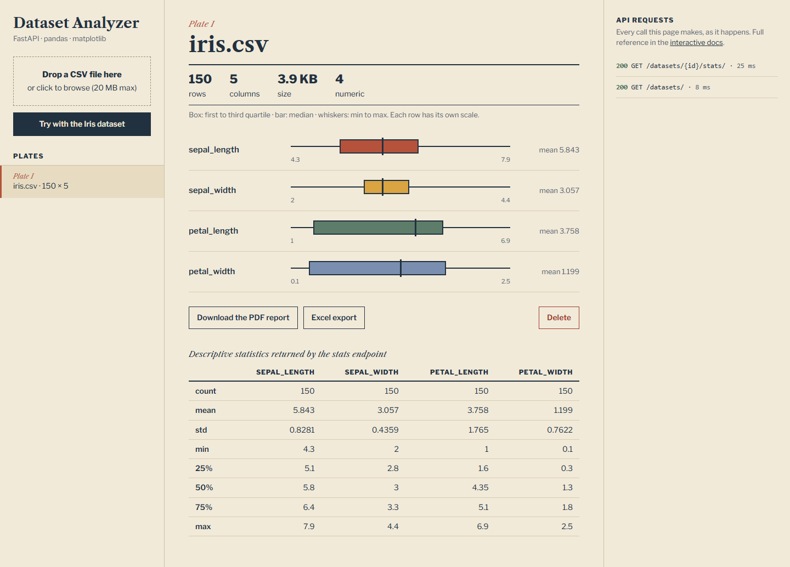

# Dataset Analyzer

A small REST API, written with FastAPI and pandas, that stores CSV files and analyses them: metadata, descriptive statistics, an Excel export and a PDF report of charts.

I built it in May 2025 as a technical test for an internship application. The brief asked for the API and a command-line client. The web page on top of it is my own addition. In November 2026 I came back to the code to fix the bugs I found, add tests and CI, and redesign the page.



## What it does

- `POST /datasets/` stores a CSV file (20 MB max) and returns its id, name, size, number of rows and columns.
- `GET /datasets/` and `GET /datasets/{id}/` list the stored files and their metadata. Metadata is kept in a JSON file, so it survives a restart.
- `GET /datasets/{id}/stats/` returns pandas' descriptive statistics (count, mean, standard deviation, min, quartiles, max) for every numeric column.
- `GET /datasets/{id}/excel/` returns the dataset as an `.xlsx` file.
- `GET /datasets/{id}/plot/` returns a multi-page PDF: histograms with a density curve, box plots and value-by-index lines for each numeric column, then a scatterplot matrix and a correlation heatmap. Charts use a 10,000-row sample and the 10 numeric columns with the highest variance, so large files stay fast.
- `DELETE /datasets/{id}/` removes the file and its metadata.

FastAPI generates the interactive documentation at `/docs`.

The web page (`/`) is a single HTML file with plain JavaScript. It uploads a file or the Iris sample, draws one box plot per numeric column from the quartiles returned by `/stats/`, shows the full statistics table and lists every request it sends to the API, with its status and duration.

## Run it

Python 3.12:

```bash
git clone https://github.com/IlyasBBB/fastapi-dataset-analyzer.git && cd fastapi-dataset-analyzer
python -m venv .venv && source .venv/bin/activate   # Windows: .venv\Scripts\activate
pip install -r requirements.txt
uvicorn app.main:app --reload
```

Then open http://127.0.0.1:8000 and click "Try with the Iris dataset".

Two environment variables are optional: `DATASETS_DIR` (where files are stored, `datasets/` by default) and `MAX_UPLOAD_MB` (20 by default).

## Command-line client

`client.py` calls the same API (it expects the server on port 8000):

```bash
python client.py upload app/static/iris.csv
python client.py list
python client.py stats <id>
python client.py plot <id>      # saves the PDF report
python client.py export <id>    # saves the Excel file
python client.py delete <id>
```

## Tests

```bash
pip install -r requirements-dev.txt
pytest -q
ruff check .
```

The 14 tests run against a temporary folder. They cover uploads (valid, empty, too large, wrong extension), unknown ids, statistics with missing values, the Excel and PDF downloads (including a file name with accents) and metadata reloading after a restart. GitHub Actions runs the linter and the tests on every push and pull request.

## Fixed in 2026

- An empty or malformed CSV caused a 500 error and left an orphan file on disk. It now returns a 400 and nothing is written.
- `/stats/` crashed whenever a column had a missing value, because pandas returns NaN and NaN is not valid JSON. Missing values now come back as `null`.
- A file name with accents broke the PDF and Excel downloads (HTTP headers are Latin-1). The response now uses the RFC 6266 `filename*` form.
- The scatterplot matrix and the heatmap used the last batch of columns, while the code comment said the first. They now use the highest-variance columns.
- The Excel export left `.xlsx` files on disk. It is now built in memory.
- The app only started from the repository root, and uploads had no size limit.

## Limitations

- No authentication: anyone who can reach the API can read or delete every file.
- Files and metadata live on the local disk, with one JSON file for the metadata and no locking. That is fine for one user, not for concurrent writes.
- PDF generation runs one report at a time (matplotlib is not thread-safe), so two large reports requested together wait for each other.
- The dependencies are the versions pinned in 2025 (FastAPI 0.109). They should be upgraded before the API is exposed publicly.

The Iris dataset in `app/static/iris.csv` comes from R. A. Fisher (1936) and is in the public domain.
